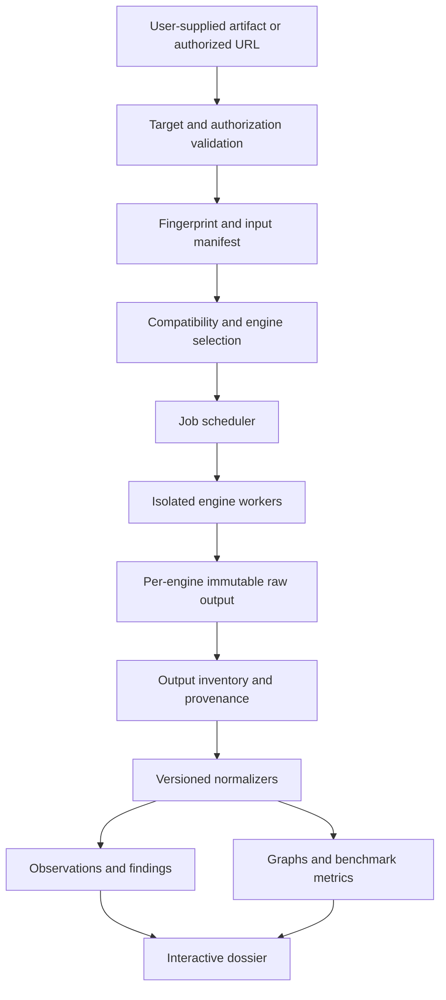

# ReverseLens Architecture Overview

## 1. System boundaries

ReverseLens consists of a control plane, an execution plane, a local artifact workspace and a presentation layer.

- **Control plane:** projects, targets, authorization records, runs, engine selection, queue state, audit events and normalized results.
- **Execution plane:** isolated, version-pinned adapters around third-party tools.
- **Workspace:** immutable input snapshots, per-engine raw outputs, normalized artifacts, graphs, benchmark metrics and reports.
- **Presentation:** run dashboard, engine result browser, code/evidence explorer, architecture graphs and benchmark comparisons.

The control plane must never parse untrusted binaries or execute external analyzers in its own process.

## 2. High-level flow

## 3. Execution isolation zones

### Zone A — Offline artifact analysis

Inputs: user-supplied APK/AAB/APKS, DEX, ELF, JavaScript bundles and archives.

Default policy:
- No network access.
- Non-root execution.
- Per-job scratch directory.
- CPU, RAM, disk, process and time quotas.
- Read-only tool image and no host credentials.
- No Docker socket passed into workers.
- Archive traversal/decompression protections.
- Outputs written only to the run's designated engine directory.

### Zone B — Authorized web capture

Inputs: URL plus an active authorization record and explicit host/path/method/budget scope.

Default policy:
- HTTP/HTTPS only.
- Explicit host allowlist.
- DNS resolution and IP-range validation before connecting.
- Revalidate redirects and every navigation/request.
- Block loopback, private, link-local, multicast, reserved and cloud metadata ranges.
- Application-layer checks plus network egress enforcement.
- Bounded request count, pages, response size, duration and concurrency.
- No cookies, credentials, login flows or private browser profiles by default.

## 4. Multi-engine execution

An engine registry entry declares its capability class, accepted inputs, expected outputs, network policy, isolation profile, resource class, dependencies, licence review and known limitations.

The scheduler selects only compatible, installed engines. It may run a compatible subset concurrently when resource budgets permit. Heavy jobs should be serialized or bounded on resource-constrained laptops.

Every engine execution receives:
- A unique execution ID.
- A private output directory under the run.
- A stable, recorded configuration.
- A bounded working directory.
- A captured stdout/stderr and exit state.
- A resource/time budget.
- An output inventory with hashes.

An engine failure must not erase or silently invalidate outputs from other engines.

## 5. Workspace layout

The authoritative layout examples are in `DEVELOPMENT_PLAN.md`. At minimum, each run contains:
- `input/`: immutable source manifest and hash.
- `engines/<engine-id>/`: raw, independent output.
- `normalized/`: derived observations and findings.
- `graphs/`: versioned graph exports.
- `benchmark/`: experiment metadata and comparison metrics.
- `reports/`: generated dossier.
- `run-manifest.json`: run-level provenance.

Do not commit target workspaces to the source repository.

## 6. Technology direction

- Frontend: Next.js and TypeScript.
- Control plane: Java and Spring Boot.
- Metadata: PostgreSQL.
- Queue: Redis.
- Worker adapters: Python, Node.js and Java according to the upstream tool.
- Isolation: Docker for development; stronger sandbox/VM and egress controls before handling untrusted or remote targets at scale.
- Artifact storage: filesystem first, object storage optional later.
- Visualization: Monaco, Cytoscape.js and React Flow.

Exact language/runtime versions will be pinned during Phase 1 compatibility tests.

## 7. Data flow and provenance

Raw output is immutable. Normalizers create new, versioned structured records. Every observation and finding references:
- Target and run.
- Engine execution, engine version and adapter version.
- Raw artifact ID/hash and file/symbol/line/URL/network event when available.
- Evidence excerpt or structured evidence.
- Confidence and review status.

A discovery is not automatically a security finding. An endpoint, permission, tracker signature or dependency match must be represented as an observation until it is triaged.

## 8. Scalability

Start local-first and single-user. Avoid distributed complexity until the local execution contract is stable. Later, workers can be moved to remote nodes, but the same authorization, provenance, storage isolation and resource policies must apply.
